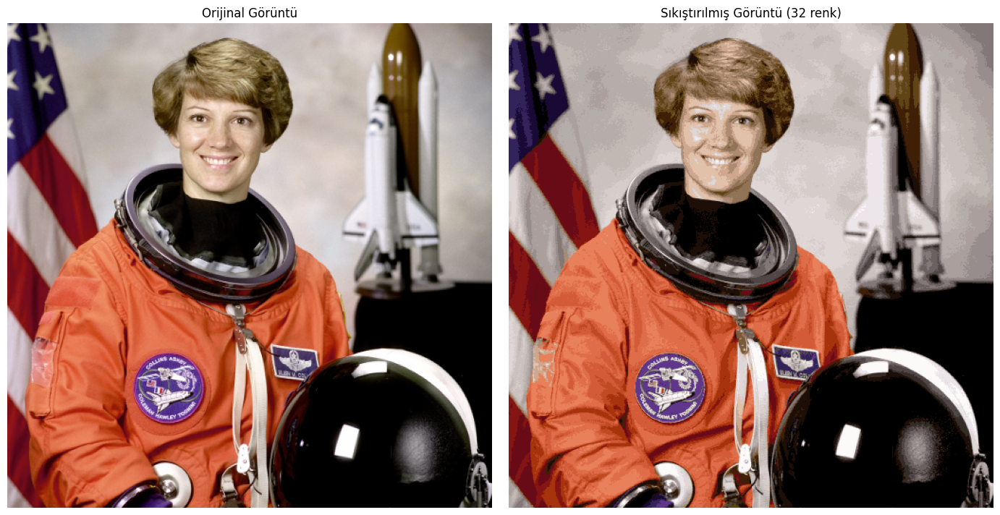

# Image Compression with K-Means Clustering

Reducing the number of colors in an image with **unsupervised learning**: every pixel is treated as an observation with three features (R, G, B), and **K-Means** groups similar colors so that each pixel can be replaced by its cluster's average color.

**Result:** the 512 × 512 test image goes from **113,382 unique colors to 32**, and it is still easy to recognize.

*Left: original. Right: compressed to 32 colors.*

## Approach
1. **Images as data:** reshaped the image from `512 × 512 × 3` into a `262,144 × 3` matrix (pixels × RGB)
2. **K-Means (k = 32):** each pixel is assigned to one of 32 clusters, and the cluster centers become the new palette
3. **Rebuilding the image:** `cluster_centers_[labels_]` → `uint8` → reshaped back to the original size and compared side by side with the original
4. **Elbow method:** plotted the inertia for k = 5 … 100 and visualised the image compressed to 1, 2, 5, 10, 20, 30, 50, 70 and 100 colors, to see the trade-off between quality and compression

## Tech
Python · scikit-learn (KMeans) · scikit-image · NumPy · Matplotlib

## Files
- `image_compression.ipynb` – main exercise
- `warmup_k_means.ipynb` – K-Means warm-up exercise
- `tests/` – automated checks

Built during the Workintech Data Science & Machine Learning program.
